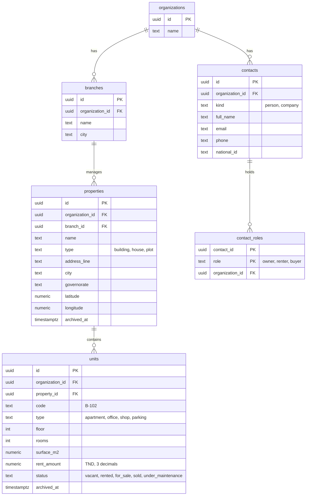

# Foundation schema (migration 0001)

Source of truth: [`db/migrations/0001_foundation.sql`](../../../db/migrations/0001_foundation.sql).
Six tables of the roughly 60 classes in the UML model. More tables are added module by module.

## Multi-tenant rule

Every business table carries `organization_id`. The foreign keys between tables are composite
(`id, organization_id`), so a unit can only belong to a property of the same organization.
Hasura filters every query by the `organization_id` found in the user's JWT.

## Conventions

- Archive with `archived_at`, never hard-delete (organizations are never deleted).
- Money: `numeric(12,3)`, Tunisian dinar.
- A contact holds one or several roles in `contact_roles` (glossary N-09: owner, renter, buyer).
